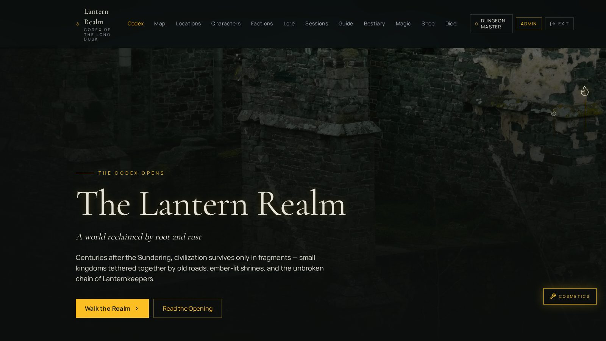
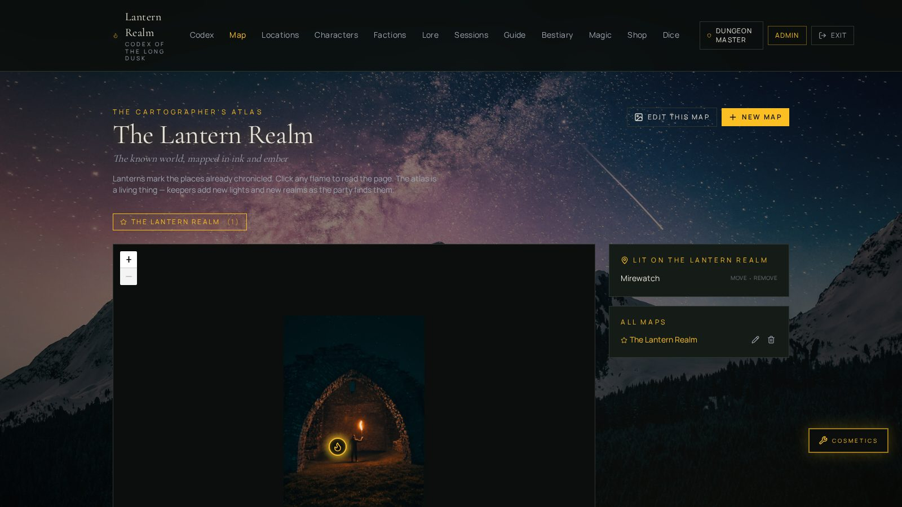
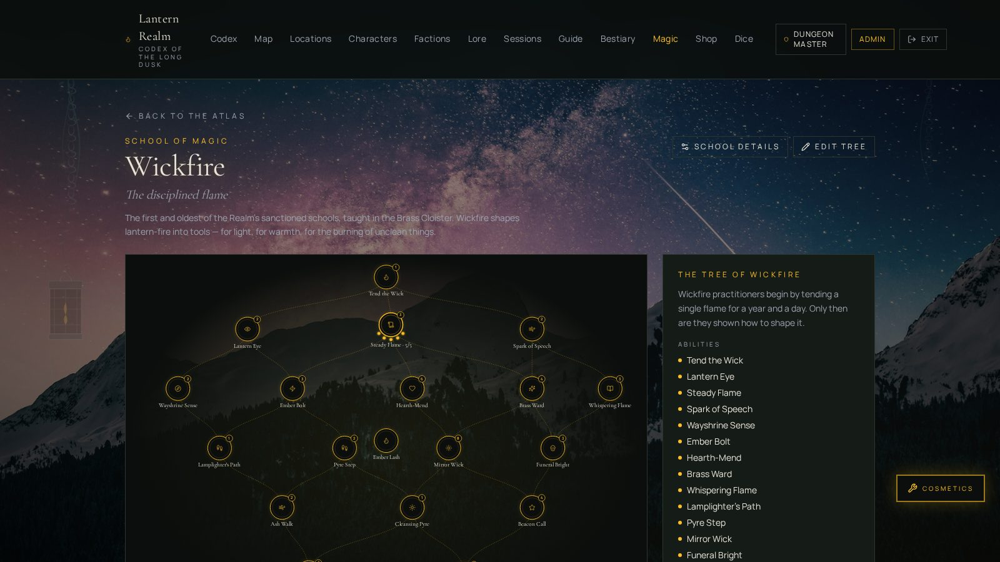
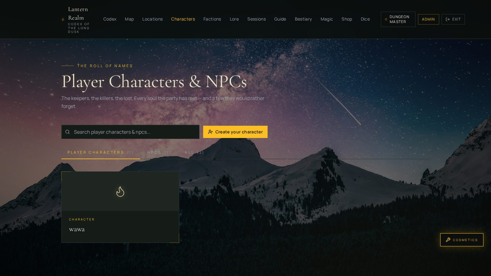
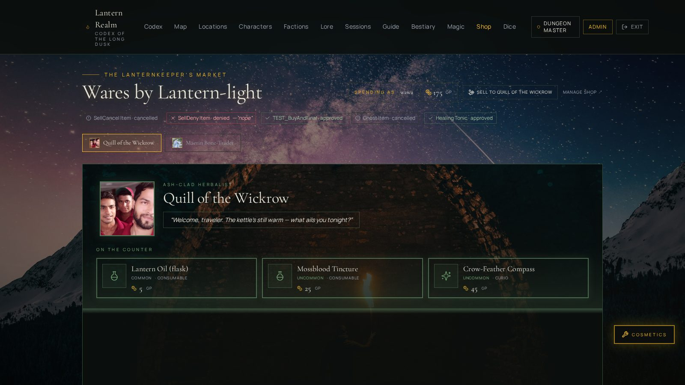
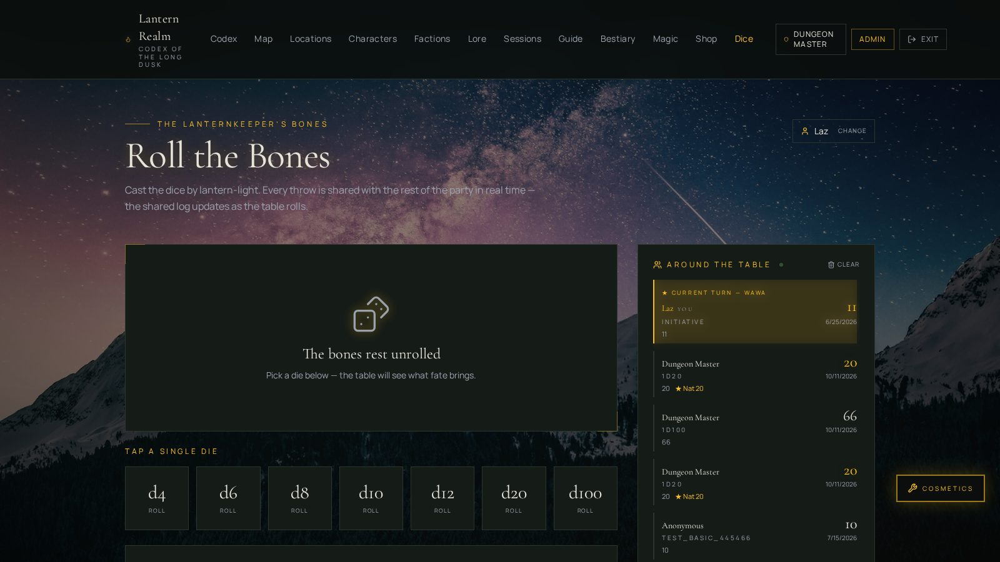
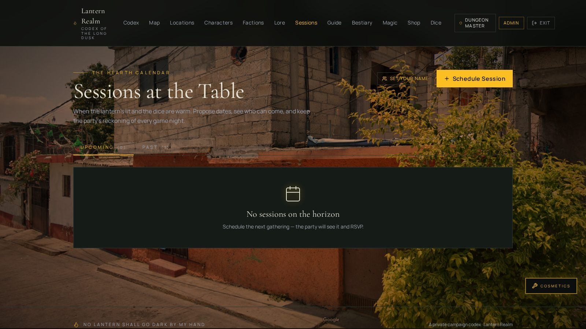
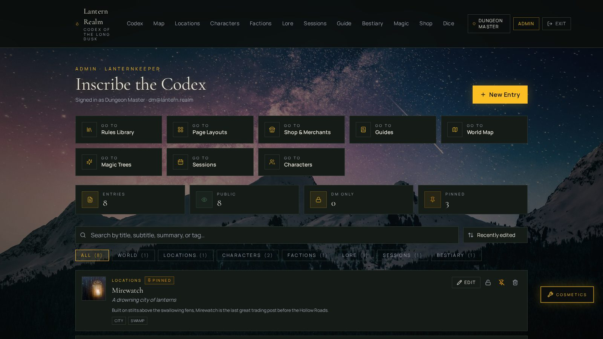
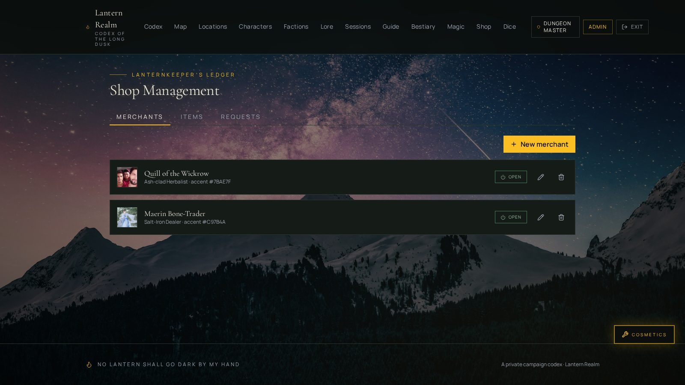
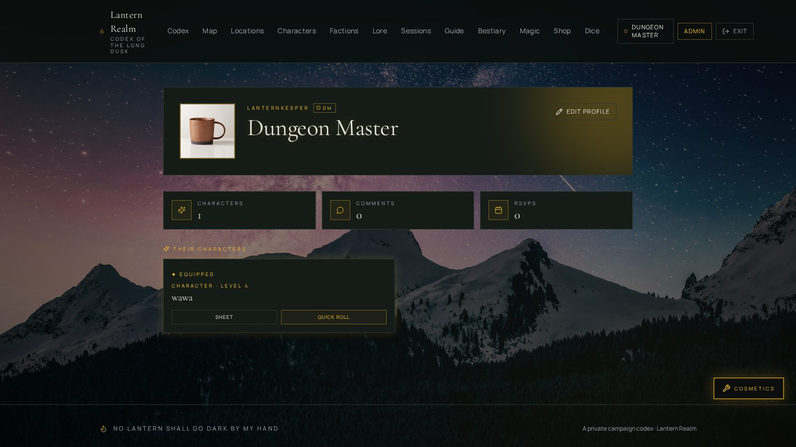

# Lantern Realm — Codex of the Long Dusk

A dark-fantasy campaign companion for a D&D 5e game. The DM and the party write all the lore by hand — **no AI touches the story.** The look is overgrown ruins, moss and lantern-light.



---

## Features

| Area | What it does |
|---|---|
| **Codex** | Locations, characters, factions, lore and bestiary entries, written in Markdown with `[[wiki-links]]`, images and DM-only (sealed) entries |
| **World Map** | Several regional maps, with lantern markers that link to codex entries |
| **Magic Skill Trees** | Origin, foundation and class schools; nodes with 1–5 ranks, sizes, colours and level locks |
| **Characters** | Full D&D 5e character builder and sheet for players; NPCs managed by the DM |
| **Communal Dice** | A shared, live dice table with every roll visible to the party |
| **Sessions** | Session planner with RSVPs and a comment thread per session |
| **Shop** | Merchants, stock, buying and selling to the merchant, and an open/closed state |
| **Guides** | A small wiki for house rules and how-tos |
| **DM Portal** | Manage entries, rules, page layouts, shops and themes |
| **Cosmetic Editor** | Backgrounds, tints, fades and decals for the whole site or a single page, with saveable "mood" presets |

## Screenshots

| | |
|---|---|
|  **World Map** |  **Magic Skill Tree** |
|  **Schools of Magic** |  **Player Characters & NPCs** |
|  **Merchant Shop** |  **Communal Dice** |
|  **Sessions** |  **Guides** |
|  **DM Portal** |  **Shop Management** |
|  **Profile** | |

## Roles

- **DM / Co-DM (admin):** can edit everything, see sealed entries, and use the portal and the cosmetic editor
- **Player:** has an account, owns characters, RSVPs to sessions, rolls dice and shops
- **Visitor:** can read public content only

## Tech Stack

- **Frontend:** React 19, React Router 7, Tailwind CSS, shadcn/ui, lucide-react, react-leaflet, marked + DOMPurify
- **Backend:** FastAPI, Motor (async MongoDB), JWT auth with httpOnly cookies, bcrypt
- **Database:** MongoDB
- **File storage:** Emergent managed object storage (for uploaded images)

```
backend/
  server.py        # FastAPI app and router wiring
  routes/          # auth, entries, guides, maps, dice, magic, sessions, pcs, rules, layouts, shop, theme
  models.py deps.py seeds.py storage.py dnd_srd.py
frontend/
  src/pages/       # Home, WorldMap, MagicTree, Dice, Sessions, Shop, Guide, Admin…
  src/components/  # Layout, ThemeLayer, CosmeticEditor, MarkdownEditor, ConfirmDialog…
  src/lib/         # theme.js, layouts.js, markdown.js
docs/screenshots/  # images used in this README
```

## Running Locally

**Requirements:** Python 3.11+, Node 18+ with Yarn, and a running MongoDB.

### Backend

```bash
cd backend
pip install -r requirements.txt
uvicorn server:app --host 0.0.0.0 --port 8001 --reload
```

Create `backend/.env` with these keys:

```
MONGO_URL=mongodb://localhost:27017
DB_NAME=lantern_realm
CORS_ORIGINS=http://localhost:3000
FRONTEND_URL=http://localhost:3000
JWT_SECRET=<a long random string>
ADMIN_EMAIL=<dm email>
ADMIN_PASSWORD=<dm password>
ADMIN_NAME=Dungeon Master
CO_DM_EMAIL=<co-dm email>
CO_DM_PASSWORD=<co-dm password>
CO_DM_NAME=Co-DM
EMERGENT_LLM_KEY=<key used for image storage>
APP_NAME=lantern-realm
```

The DM and Co-DM accounts, plus starter content, are created automatically the first time the server starts.

### Frontend

```bash
cd frontend
yarn install
yarn start
```

Create `frontend/.env`:

```
REACT_APP_BACKEND_URL=http://localhost:8001
```

All API routes start with `/api`.

> **Note:** `.env` files and database contents are not included in the repository. Never commit real passwords or keys.
